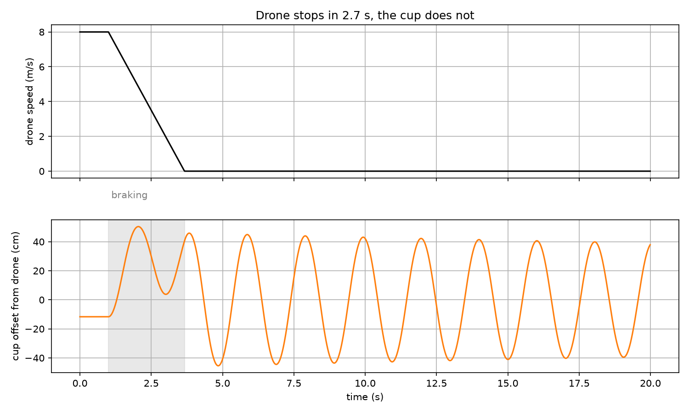
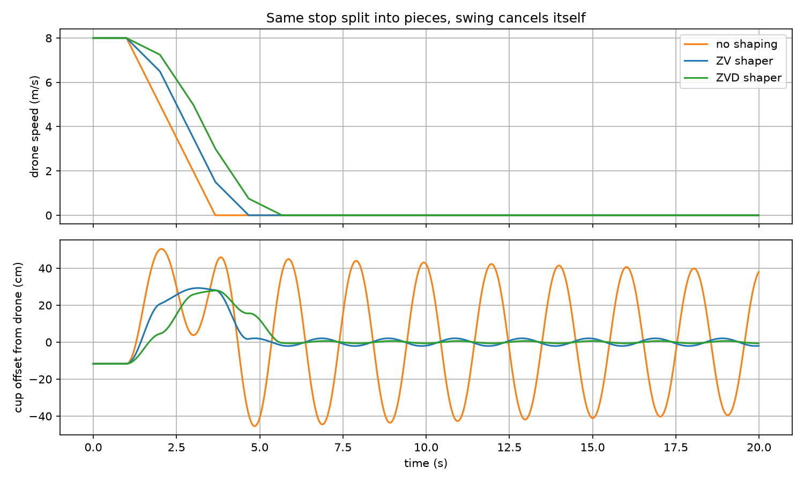
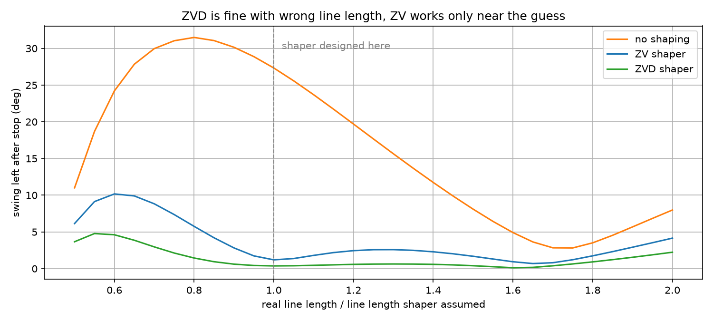
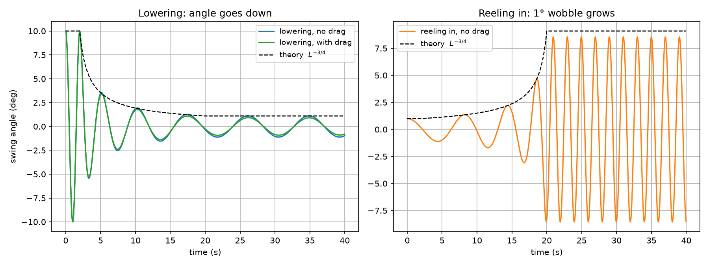
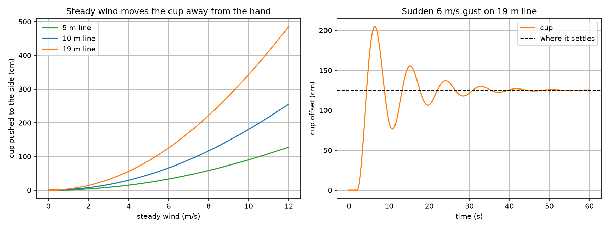

# the cup on the rope – why a delivery drone's payload swings and how to stop it

**the issue:** a delivery drone that lowers your order on a line is
carrying a pendulum. every time it brakes or a gust hits, the cup
starts swinging, and on a 19 m line one swing takes almost 9 seconds
and only air drag stops it. i'm building mote, a small quiet drone
that lowers one coffee into your hand, so i had to figure this out.

## my approach

1. model the drone and the hanging cup from the equations of motion (moving pivot, changing line length, air drag)
2. show how much the cup swings after a normal stop: 27° on a 1 m line, ±46 cm
3. cancel the swing with input shaping (ZV and ZVD shapers, braking split into timed pieces)
4. test how the shapers hold up when the line length is guessed wrong
5. check what lowering and reeling in do to the swing against the adiabatic invariant theory
6. measure how far wind pushes the cup and whether swinging spills coffee

## outcomes

splitting the braking with a ZV shaper cut the leftover swing from 27°
to 1.2° for one extra second of braking. ZVD stays under 1° even with a
line 30% longer than it assumed. lowering the cup shrinks the swing angle
as L^-3/4 but the cup drifts further sideways as L^1/4, and reeling the
line back in pumps a 1° wobble up to 8.6°. a 6 m/s wind pushes the cup
1.25 m off on a 19 m line. and smooth swinging doesn't spill coffee,
the cup just tilts together with the gravity it feels.

## visual representations

### the drone stops, the cup does not

### input shaping cancels the swing

### what if the line length is wrong

### lowering vs reeling in

### wind

## technology stack

- numpy, scipy (solve_ivp for the equations of motion)
- matplotlib
- methods applied: pendulum model, ZV / ZVD input shaping, adiabatic invariants

the numbers (450 g cup, 8 m/s cruise, 3 m/s² braking, 20 m hover) are
design targets for mote, not measurements yet.
